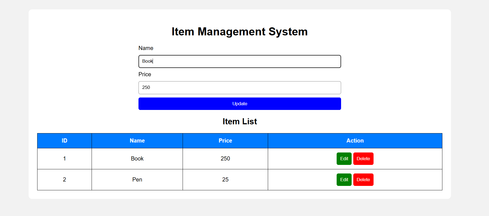

# MERN CRUD - Item Management System

## Project Description
This project is an Item Management System that performs CRUD operations.

## Technologies Used
- HTML
- CSS
- JavaScript
- Node.js
- Express.js
- REST API

## Features
- Add new items
- View item list
- Edit item details
- Delete items

## Project Output

## How to Run

1. Install Node.js.
2. Open the project folder in VS Code.
3. Run npm install.
4. Run node server.js.
5. Open http://localhost:3000 in your browser.
## Project Output

